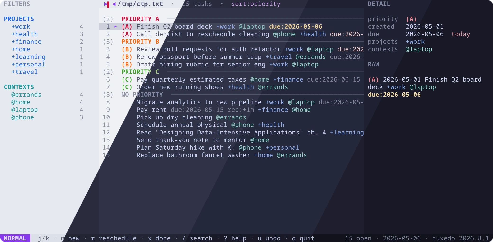
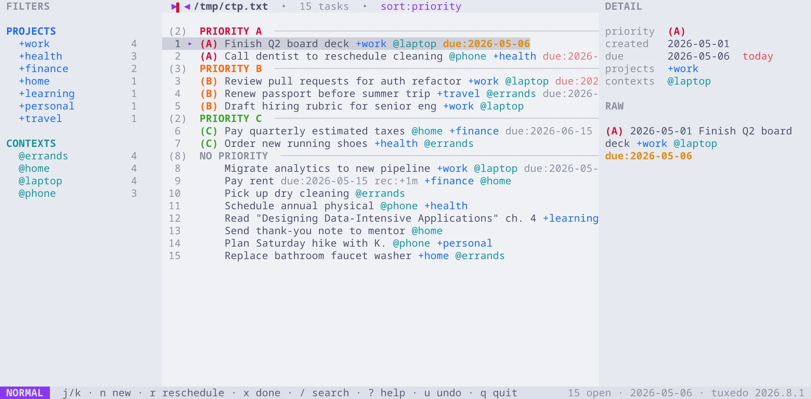
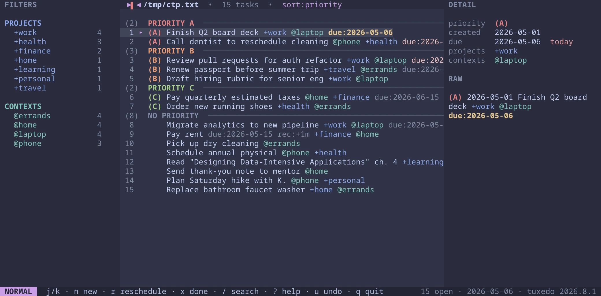
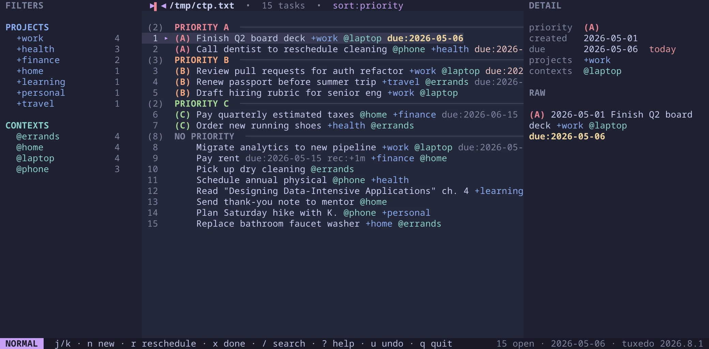
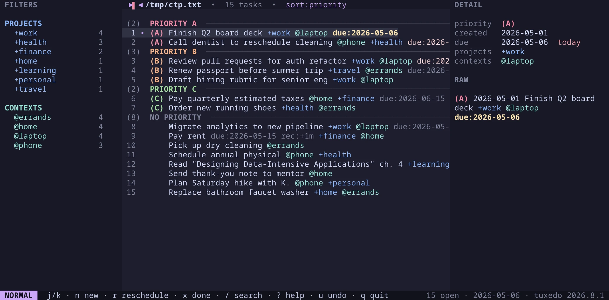

<h3 align="center">
	<br/>
	
	Catppuccin for <a href="https://github.com/webstonehq/tuxedo">Tuxedo</a>
	
</h3>

<p align="center">
	<a href="https://github.com/MBeggiato/tuxedo/stargazers"></a>
	<a href="https://github.com/MBeggiato/tuxedo/issues"></a>
	<a href="https://github.com/MBeggiato/tuxedo/contributors"></a>
</p>

<p align="center">
	
</p>

## Previews

<details>
<summary>🌻 Latte</summary>

</details>
<details>
<summary>🪴 Frappé</summary>

</details>
<details>
<summary>🌺 Macchiato</summary>

</details>
<details>
<summary>🌿 Mocha</summary>

</details>

## Usage

1. Copy the flavor(s) of your choice from [`themes/`](themes) into Tuxedo's
   themes directory:

   ```sh
   mkdir -p ~/.config/tuxedo/themes
   cp themes/catppuccin-*.toml ~/.config/tuxedo/themes/
   ```

   (`$XDG_CONFIG_HOME/tuxedo/themes/` is used if `XDG_CONFIG_HOME` is set.)

2. Start Tuxedo and press `T` to open the theme picker, then select a
   Catppuccin flavor. The choice is persisted across runs.

See Tuxedo's [custom themes documentation](https://github.com/webstonehq/tuxedo#custom-themes)
for details on the theme file format.

## 💝 Thanks to

- [MBeggiato](https://github.com/MBeggiato)
- [jman223](https://github.com/jman223), for the original Catppuccin themes contributed to Tuxedo

&nbsp;

<p align="center">
	
</p>

<p align="center">
	Copyright &copy; 2021-present <a href="https://github.com/catppuccin" target="_blank">Catppuccin Org</a>
</p>

<p align="center">
	<a href="https://github.com/catppuccin/catppuccin/blob/main/LICENSE"></a>
</p>
